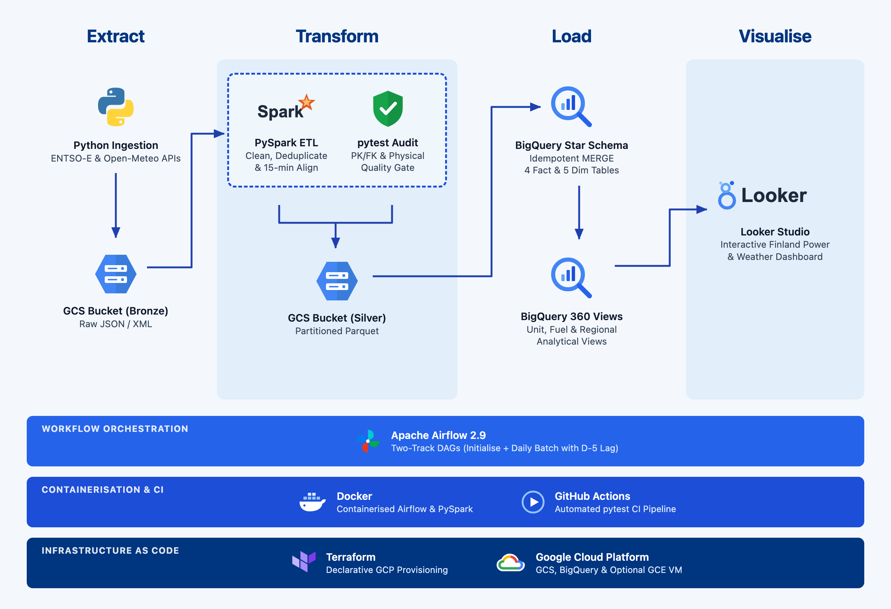
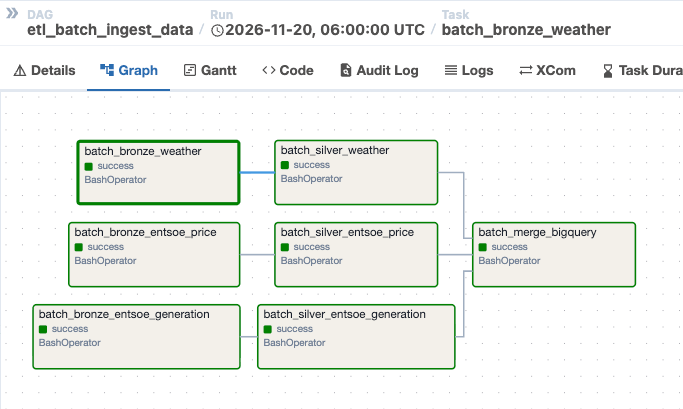
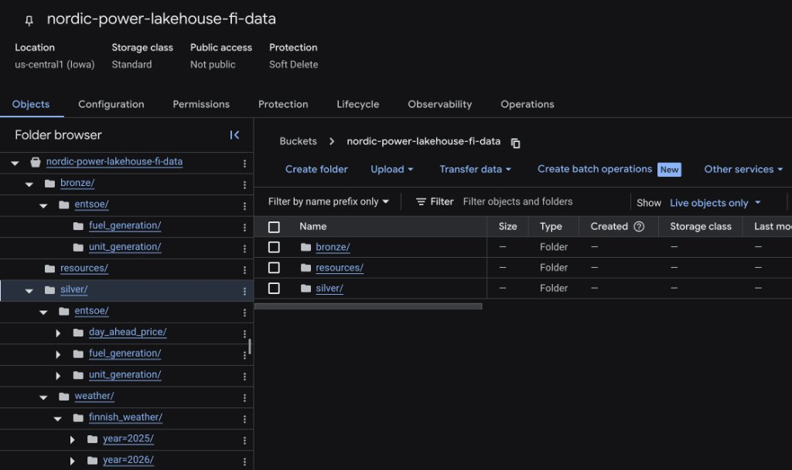
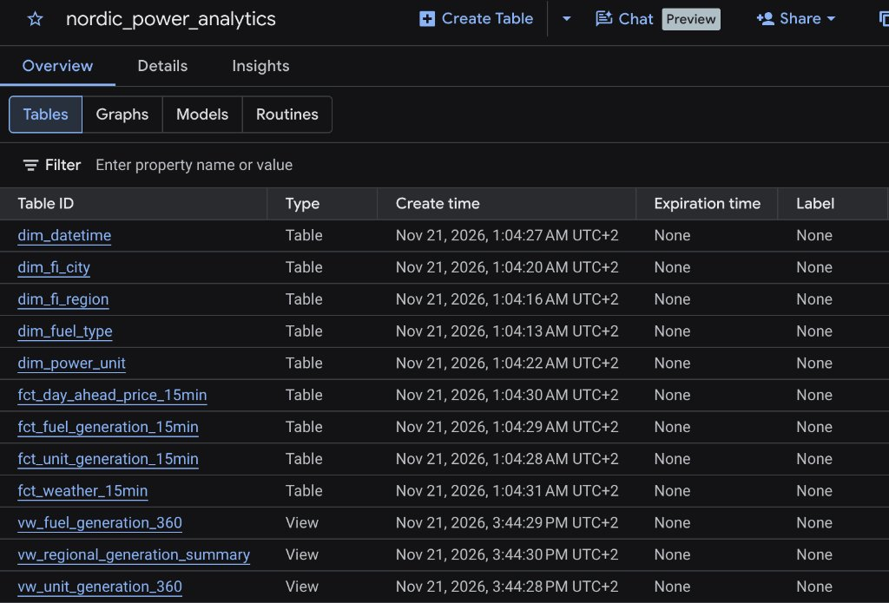
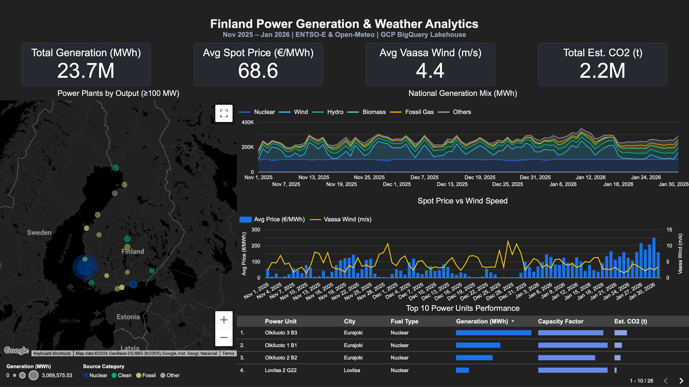

# Nordic Power Lakehouse — Finland Power Generation Analytics


An end-to-end batch data pipeline on **Google Cloud Platform (GCP)** that extracts, validates, models, and visualises 15-minute electricity generation data for **Finland (FI)**, enriched with day-ahead spot prices and weather telemetry.



---

## Table of Contents

1. [Project Description & Problem Statement](#1-project-description--problem-statement)
2. [Data Sources](#2-data-sources)
3. [Technologies & Project Structure](#3-technologies--project-structure)
4. [Data Pipeline Design](#4-data-pipeline-design)
5. [Storage and Data Warehouse](#5-storage-and-data-warehouse)
6. [Data Visualisation](#6-data-visualisation)
7. [How to Reproduce](#7-how-to-reproduce)

---

## 1. Project Description & Problem Statement

### Background & Motivation
While studying for my Master's degree in Finland, I became interested in the Nordic energy sector and the many energy-tech companies operating here. Finland has an unusually dynamic power grid, combining nuclear baseload with rapidly growing wind power and 15-minute wholesale pricing that reacts sharply to winter weather. I built this project to explore real Finnish grid data while practicing end-to-end cloud data engineering on GCP.

### Why This Project Started
Understanding how a national power grid actually runs requires combining **individual power plant output**, **national fuel mix**, **estimated `CO₂` emissions**, **wholesale electricity prices**, and **weather**. However, public energy data in Finland is scattered across different sources with incompatible formats, time resolutions, and update rules, which makes it hard to query or analyse in one place.

### The Core Problems Solved
- **Scattered sources & mismatched formats**: ENTSO-E serves XML across separate endpoints (`A73` units, `A75` fuel mix, `A44` prices), while Open-Meteo serves hourly JSON weather that must be aligned to 15-minute UTC / Helsinki power intervals.
- **Strict API limits & publication delays**: ENTSO-E `A73` enforces a **1-day maximum query window** (returning `HTTP 400` on longer ranges) and a **5-day publication delay (`D-5`)**, so naive daily batch jobs fail or pull empty files.
- **Missing plant & carbon metadata**: Raw `A73` records only expose opaque `unit_mrid` codes with no city, region, coordinates, active status, or `CO₂` emission factor -> requiring curated, verified reference tables.
- **Silent upstream schema changes**: New fuel codes (such as `B25` Energy Storage) can appear without notice and break downstream dashboards unless automated quality checks catch them first.

### What This Pipeline Demonstrates
Rather than loading a static CSV, this project focuses on practical batch pipeline habits:
- **Terraform**: creates the GCS bucket and BigQuery dataset from code instead of manual console setup.
- **Airflow in Docker**: schedules daily runs and handles real ENTSO-E API limits (1-day query cap and 5-day unit data lag).
- **BigQuery `MERGE` & partitioning**: prevents duplicate rows on retries or backfills and keeps queries fast.
- **`pytest` & GitHub Actions**: checks keys, non-negative values, and unit-vs-national totals automatically before dashboards read the data.

---

## 2. Data Sources

| Dataset | Source | Frequency | How It Was Collected |
| :--- | :--- | :--- | :--- |
| **Actual Generation per Unit (`A73`)** | [ENTSO-E Transparency API](https://transparency.entsoe.eu/) | 15-min (`D-5` lag) | Pulled via Python REST client (`ingestion/entsoe_generation.py`) in 1-day XML chunks to respect ENTSO-E's `A73` query cap. |
| **Actual Generation per Fuel Type (`A75`)** | [ENTSO-E Transparency API](https://transparency.entsoe.eu/) | 15-min | Pulled via Python REST client (`ingestion/entsoe_generation.py`) in 7-day XML chunks across 14 PSR fuel codes (`B01`–`B25`). |
| **Day-Ahead Spot Prices (`A44`)** | [ENTSO-E Transparency API](https://transparency.entsoe.eu/) | 15-min / Hourly | Pulled via Python REST client (`ingestion/entsoe.py`) for the Finland (`FI`) bidding zone (`€/MWh`). |
| **Historical Weather** | [Open-Meteo Archive API](https://open-meteo.com/) | Hourly → 15-min | Pulled via Python JSON API (`ingestion/weather.py`) for Helsinki (temperature) and Vaasa (coastal wind speed). |
| **Static Reference Tables (`resources/`)** | Manually curated CSVs | Static | **Manually researched and cross-verified**: extracted all 32 `unit_mrid` keys from `A73`, verified capacities against ENTSO-E `A71`, manually mapped operators, active/retired status, 28 host cities, and 19 Finnish regions, and compiled `IPCC AR5` `carbon_g_per_kwh` emission factors for all 15 PSR fuel codes. |

---

## 3. Technologies & Project Structure

### Tech Stack

| Layer | Technology | Role |
| :--- | :--- | :--- |
| **Infrastructure as Code** | Terraform | Provisions GCS bucket (`us-central1`), BigQuery dataset (`US`), and optional GCE VM (`start_up_script.sh`) |
| **Data Lake** | Google Cloud Storage (GCS) | Stores raw JSON/XML (`bronze/`), reference CSVs (`resources/`), and cleaned Parquet (`silver/`) |
| **Batch Processing** | Apache Spark (PySpark) | Enforces schemas, removes duplicates, converts MW → MWh, and aligns timestamps to 15-min UTC & Helsinki time |
| **Data Quality & CI** | `pytest` & GitHub Actions | Runs 6 automated integrity and physical consistency checks on every push/PR |
| **Data Warehouse** | Google BigQuery | Stores partitioned/clustered Star Schema tables via idempotent `MERGE` and 3 analytical views |
| **Orchestration** | Apache Airflow 2.9 (Docker) | Runs two-track DAGs (one-time initialisation + daily incremental batch) |
| **BI & Visualisation** | Looker Studio | Live dashboard connected directly to BigQuery 360 views |

### Project Structure

```text
.
├── .github/workflows/ci.yml           # GitHub Actions pytest CI
├── Dockerfile                         # Airflow 2.9 + Java + PySpark
├── docker-compose.yml                 # Local Airflow stack
├── requirements.txt
├── run_pipeline.sh                    # Local Bronze → Silver → pytest → Gold runner
├── start_up_script.sh                 # Optional GCE VM setup script
├── terraform/                         # GCS bucket, BigQuery dataset & optional VM
├── common/                            # Config, schemas, paths, BigQuery SQL & MERGE
├── ingestion/                         # Bronze API scripts, Silver PySpark ETL, BigQuery loader
├── dags/                              # etl_initialise_data.py & etl_batch_ingest_data.py
├── resources/                         # 4 manually curated Dimension CSVs
├── media/                             # Architecture, Airflow, GCP & dashboard visuals
└── tests/
    └── test_pipeline_integrity.py     # 6 automated data quality tests
```

---

## 4. Data Pipeline Design

The pipeline is split into two Airflow DAGs running in Docker (`dags/`):

### 4.1 Initialisation Data Ingestion (`etl_initialise_data` — `@once`)
One-time setup DAG that bootstraps the lakehouse:
1. Extracts initial historical Bronze data for ENTSO-E (`A73`, `A75`, `A44`) and Open-Meteo weather into GCS.
2. Runs PySpark Silver transformations to produce cleaned, partitioned Parquet files.
3. Loads the 4 curated Dimension CSVs (`resources/`) and generates `dim_datetime`.
4. Creates BigQuery Fact tables, merges initial Silver records, and deploys the 3 analytical 360 views.

### 4.2 Incremental Batch Ingestion (`etl_batch_ingest_data` — `0 6 * * *`)
Daily batch DAG running at 06:00 UTC:
1. **Weather, Spot Price & National Fuel Mix (`D-2` to `D`)**: Fetches recent 2-day lookback windows to capture late updates.
2. **Unit-Level Generation (`A73`, `D-7` to `D-5`)**: Uses a 5-day offset (`UNIT_PUBLICATION_LAG_DAYS = 5`) and 1-day chunking (`max_chunk_days: 1`) to handle ENTSO-E `A73` API limits cleanly.
3. **PySpark Silver → BigQuery `MERGE`**: Transforms each batch to Parquet and runs idempotent SQL `MERGE` into BigQuery so reruns never create duplicates.



### 4.3 Data Quality Gate (`pytest` + GitHub Actions CI)
`tests/test_pipeline_integrity.py` runs 6 automated checks locally and via `.github/workflows/ci.yml`:
1. Primary key uniqueness across all static Dimension CSVs.
2. 100% foreign key match (`unit_mrid`, `entsoe_psr_code`, `city`, `region`).
3. Non-negative values and zero duplicate rows in Silver unit Parquet.
4. Non-negative values and valid PSR fuel codes in Silver fuel Parquet (automatically caught newly reported `B25` Energy Storage in Finland).
5. Schema and range validation on weather and spot price Parquet.
6. **Physical cross-check**: `B14` Nuclear relative difference between `A73` (unit sum) and `A75` (national) `< 1%`, and `SUM(A73) <= SUM(A75)`.

---

## 5. Storage and Data Warehouse

### 5.1 Google Cloud Storage (Data Lake)
Bucket: `gs://nordic-power-lakehouse-fi-data` (`us-central1`)

```text
gs://nordic-power-lakehouse-fi-data/
├── bronze/
│   ├── entsoe/
│   │   ├── unit_generation/     # Raw XML (A73 power units)
│   │   ├── fuel_generation/     # Raw XML (A75 national fuel mix)
│   │   └── day_ahead_price/     # Raw XML (A44 spot prices)
│   └── weather/                 # Raw JSON (Open-Meteo Helsinki & Vaasa)
├── resources/                   # Static reference seed CSVs
└── silver/
    ├── entsoe/
    │   ├── unit_generation/     # Partitioned Parquet (15-min per unit)
    │   ├── fuel_generation/     # Partitioned Parquet (15-min per PSR code)
    │   └── day_ahead_price/     # Partitioned Parquet (15-min FI prices)
    └── weather/
        └── finnish_weather/     # Partitioned Parquet (year=2025, year=2026)
```



### 5.2 Google BigQuery (Data Warehouse)
Dataset: `nordic_power_analytics` (`US`). All Fact tables are **date-partitioned** (`date_start_helsinki`) and **clustered** for low-cost queries, and updated via **staging tables + SQL `MERGE`**.



| Type | Table / View | Description |
| :--- | :--- | :--- |
| **Fact** | `fct_unit_generation_15min` | 15-min generation per power unit (`unit_mrid`, `generation_mw`, `generation_mwh`) |
| **Fact** | `fct_fuel_generation_15min` | 15-min national generation per PSR fuel code (`entsoe_psr_code`, `generation_mwh`) |
| **Fact** | `fct_day_ahead_price_15min` | Finland day-ahead wholesale price (`price_eur_per_mwh`) |
| **Fact** | `fct_weather_15min` | Helsinki temperature (`temp_c`) & Vaasa wind speed (`wind_speed_ms`) |
| **Dim** | `dim_power_unit` | 32 Finnish units (`≥ 100 MW`) with capacity, operator, city, region, coordinates, active flag |
| **Dim** | `dim_fuel_type` | 15 ENTSO-E PSR codes mapped to categories (`Nuclear`, `Clean`, `Fossil`, `Other`) + `carbon_g_per_kwh` |
| **Dim** | `dim_fi_city` | 28 Finnish municipalities with coordinates |
| **Dim** | `dim_fi_region` | 19 Finnish regions (English & Finnish names + centroids) |
| **Dim** | `dim_datetime` | 15-min UTC & `Europe/Helsinki` calendar (`hour_helsinki`, `is_peak_hour`, `is_weekend`, `season`) |
| **View** | `vw_unit_generation_360` | Unit output + location + capacity factor + estimated `CO₂` |
| **View** | `vw_fuel_generation_360` | National fuel mix + estimated `CO₂` + spot price + weather |
| **View** | `vw_regional_generation_summary` | Regional roll-up of generation and estimated `CO₂` |

Full table DDL and view SQL are in [`common/bq_queries.py`](common/bq_queries.py).

---

## 6. Data Visualisation

The Looker Studio dashboard connects directly to `vw_unit_generation_360` and `vw_fuel_generation_360` in BigQuery.



Key metrics from the loaded **Nov 2025 – Jan 2026** winter dataset (92 days):
- **23.7M MWh** total national generation and **2.2M t** estimated `CO₂` (~93 gCO₂/kWh average carbon intensity).
- **Nuclear Baseload**: `Olkiluoto 3 B3`, `Olkiluoto 1 B1`, `Olkiluoto 2 B2`, and `Loviisa 2 G22` lead total winter output with high capacity factors.
- **Market & Weather Context**: Average spot price was **68.6 €/MWh** at **4.4 m/s** average Vaasa wind speed, with low-wind cold spells (e.g. late Jan 2026) pushing prices above **200 €/MWh**.

---

## 7. How to Reproduce

### 7.1 Prerequisites
1. **Google Cloud Platform (GCP)** account and project:
   - Enable **Cloud Storage** and **BigQuery** APIs.
   - Authenticate either via a Service Account JSON key (`Storage Admin` & `BigQuery Admin` roles) or Application Default Credentials (`gcloud auth application-default login`).
2. **ENTSO-E Transparency Platform API Token**:
   - Register for a free account at [transparency.entsoe.eu](https://transparency.entsoe.eu/) and request a Security Token.
3. **Local Tools**:
   - [Docker & Docker Compose](https://www.docker.com/)
   - [Terraform](https://developer.hashicorp.com/terraform/downloads) (`>= 1.5`)
   - Python `3.11` & Java `17` (only needed if running PySpark outside Docker)

### 7.2 Provision GCP Infrastructure (Terraform)
```bash
cd terraform
terraform init
terraform apply \
  -var="project=YOUR_GCP_PROJECT_ID" \
  -var="gcs_bucket_name=YOUR_UNIQUE_BUCKET_NAME"
```
*(By default `create_vm = false` to stay within GCP Always Free Tier. Pass `-var="create_vm=true"` to also create a GCE VM bootstrapped with `start_up_script.sh`.)*

### 7.3 Configure Environment Variables
```bash
cp .env.example .env
```
Update `.env` with your values:
```env
ENTSOE_API_KEY=your_entsoe_security_token
GCP_PROJECT_ID=your_gcp_project_id
GCS_BUCKET_NAME=your_unique_gcs_bucket_name
BQ_DATASET_NAME=nordic_power_analytics
GOOGLE_APPLICATION_CREDENTIALS=/path/to/gcp-credentials.json
GCP_CREDENTIALS_PATH=/path/to/gcp-credentials.json
```

### 7.4 Run the Pipeline

**Option A — Containerised Apache Airflow (Recommended)**
```bash
docker compose up -d --build
```
Open **`http://localhost:8080`** (`airflow` / `airflow`):
1. Trigger **`etl_initialise_data`** once to load Dimensions, initial data (`2025-11-01` to `2025-11-04` by default), and 360 Views.
2. Unpause **`etl_batch_ingest_data`** for automated daily 06:00 UTC incremental runs.

**Option B — Local CLI & Quality Gate**
```bash
pip install -r requirements.txt
set -a && source .env && set +a
./run_pipeline.sh
```
Run the automated integrity test suite directly at any time:
```bash
pytest -v
```
