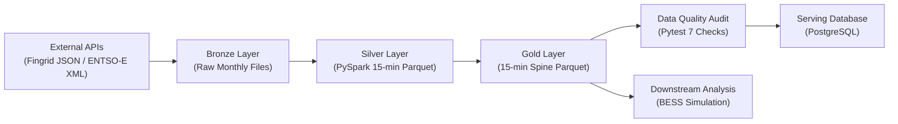

# Nordic Power Market Lakehouse (Finland)

This project builds a batch data pipeline that collects Finnish electricity grid data from **Fingrid** and Day-Ahead wholesale spot prices from **ENTSO-E**, standardises them onto a 15-minute time grid using **PySpark**, validates data integrity with **pytest**, and loads the final dataset into **PostgreSQL**.

To test whether the final Gold table is directly usable for downstream analysis, the repository also includes a simple **Battery Energy Storage System (BESS)** Day-Ahead arbitrage simulation notebook covering November 2025 to October 2026 (`35,040` quarter-hour intervals).

---

## 1. Architecture & Tech Stack



| Layer / Role | Tool | Purpose in This Project |
| :--- | :--- | :--- |
| **Ingestion (Bronze)** | Python (`requests`, `dotenv`) | Fetch monthly Fingrid JSON and ENTSO-E XML files with retry backoff and local file caching |
| **Transformation (Silver & Gold)** | Apache Spark (`PySpark`), Parquet | Standardise timestamps to UTC, align mixed time resolutions to 15 minutes, and join onto a continuous time spine |
| **Data Quality Audit** | `pytest`, `pandas`, `numpy` | Verify row continuity, DST transitions, physical bounds, and null counts before database loading |
| **Serving Database** | PostgreSQL (`SQLAlchemy`, `psycopg2`) | Store the verified Gold table (`power_market_15min`) with `start_time_utc` as the primary key |
| **Orchestration & Runtime** | Bash (`run_pipeline.sh`), Apache Airflow (`DAG`), Docker Compose | Run the full workflow locally or in containers, and define task dependencies for daily scheduling |
| **CI Validation** | GitHub Actions (`.github/workflows/ci.yml`) | Check shell/Python syntax and run the `pytest` suite against fixture data on every push |
| **Downstream Analytics** | Jupyter, `scipy`, `matplotlib` | Compare rule-based BESS arbitrage against a linear programming (LP) upper bound |

---

## 2. Key Engineering Challenges & How They Were Handled

### 2.1 Aligning Mixed Time Resolutions (`3-min` and `60-min` to `15-min`)
- **Issue**: Fingrid reports nuclear and hydro output every 3 minutes, while ENTSO-E XML files mix hourly (`PT60M`) and 15-minute (`PT15M`) price periods and omit `<Point>` tags whenever the price stays unchanged from the previous step. Fingrid wind sensors also record occasional small negative values during turbine self-consumption.
- **Approach**:
  - In `silver_entsoe.py`, omitted XML price points (`1,187` intervals across the year) are forward-filled within each period, and `PT60M` prices are expanded into four 15-minute intervals.
  - In `silver_fingrid.py`, 3-minute series are downsampled to 15-minute averages, and negative generation readings (`73` wind records) are clamped to `0.0` MW and logged.

### 2.2 Timezone Normalisation and Dynamic Daylight Saving Time (DST) Checks
- **Issue**: In Finnish local time (`Europe/Helsinki`), Daylight Saving Time shifts make one spring day 23 hours long (`92` intervals) and one autumn day 25 hours long (`100` intervals), with repeated local `03:00–03:45` timestamps in October. Hardcoding specific DST dates breaks automated runs in future years.
- **Approach**:
  - All joins, sorting, and primary keys use **UTC (`start_time_utc`)**, which is strictly unique and free of DST jumps. Local Helsinki timestamps are derived via Spark's IANA timezone database (`from_utc_timestamp`).
  - In `tests/test_gold_integrity.py`, instead of hardcoding calendar dates, `_last_sunday(year, month)` dynamically calculates the European Union DST transition rules (last Sunday of March = `92` rows, last Sunday of October = `100` rows, normal days = `96` rows) for any year present in the data.

### 2.3 Spine Time-Grid Join and Bounded 1-Step Forward Fill
- **Issue**: Joining tables directly on a single source table drops timestamps if that source has a missing record. Conversely, applying an unbounded forward fill silently hides multi-hour API outages.
- **Approach**:
  - `gold_power_balance_15min.py` first generates an independent 15-minute UTC sequence (`35,040` rows) as the base spine and left-joins all five Silver datasets onto it.
  - Because electricity generation and consumption are continuous physical time series that do not change drastically over a single 15-minute step, isolated 1-step gaps (`1` interval in `wind_mw` and `1` in `consumption_mw`) are filled with the exact value from 15 minutes earlier (`rowsBetween(-1, 0)`), avoiding look-ahead bias.
  - Every missing timestamp is logged as a `WARNING` before filling. If **two or more consecutive intervals (30+ minutes)** are missing, the second interval remains `NULL`, logs an `ERROR`, and causes `pytest` (`set -e`) to halt the pipeline before `load_postgres.py` runs.

---

## 3. Data Model

### 3.1 Silver Layer Schema (`data/silver/`)
Each Silver table (`wind_generation`, `nuclear_generation`, `hydro_generation`, `total_consumption`, `day_ahead_price`) contains only standardised timestamps and its cleaned measurement:
- `start_time_utc` (`timestamp`), `start_time_helsinki` (`timestamp`), `<metric_col>` (`double`), and `year` (`int`, partition key), plus `source_resolution` (`string`) in the ENTSO-E price table.

### 3.2 Gold Layer & PostgreSQL Schema (`power_market_15min`)
Redundant intermediate fields (such as raw day-of-week integers or unpartitioned month numbers) were removed so that every column in the Gold table has a clear analytical or structural role:

| Column | Type | Why It Exists |
| :--- | :--- | :--- |
| `start_time_utc` | `timestamp` | **Primary Key**. Continuous 15-minute UTC spine timestamp with no DST duplicates |
| `start_time_helsinki` | `timestamp` | Local Finnish timestamp (`Europe/Helsinki`) for local time-of-day analysis and plotting |
| `date_start_helsinki` | `date` | Local calendar date used to verify daily interval counts (`92` / `96` / `100`) across DST shifts |
| `year` | `int` | Partition key (`partitionBy("year")`) used to organise Parquet files without small-file fragmentation |
| `is_weekend` | `boolean` | Flags Saturday and Sunday in local time (`True`/`False`) without Spark vs. Pandas weekday numbering confusion |
| `is_peak_hour` | `boolean` | Flags weekday daytime hours (`08:00–20:00` Helsinki time) for peak vs. off-peak price comparisons |
| `wind_mw` | `double` | Domestic wind power generation (`MW`) |
| `nuclear_mw` | `double` | Domestic nuclear baseload generation (`MW`) |
| `hydro_mw` | `double` | Domestic hydroelectric generation (`MW`) |
| `consumption_mw` | `double` | Total electricity consumption in Finland (`MW`) |
| `price_eur_per_mwh` | `double` | ENTSO-E Day-Ahead wholesale spot price (`EUR/MWh`) |
| `selected_generation_mw` | `double` | Sum of the three ingested generation sources (`wind_mw + nuclear_mw + hydro_mw`) |
| `selected_gen_balance_mw` | `double` | Supply gap between the three ingested sources and total demand (`selected_generation_mw - consumption_mw`) |
| `wind_share_selected_ratio` | `double` | Wind share (`0.0–1.0`) within `selected_generation_mw`, used to analyse wind price cannibalisation |

---

## 4. Downstream Use Case: BESS Arbitrage Simulation

Notebook: [`notebooks/bess_simulation.ipynb`](notebooks/bess_simulation.ipynb) (`10 MWh` capacity, `5 MW` power rating, `90.25%` round-trip efficiency, `10%–90%` usable SoC window).

### Key Findings from the 1-Year Gold Dataset
1. **Wind Oversupply & Negative Prices**:
   - When wind accounts for `>= 50%` of selected generation, the average spot price drops to **`12.40 EUR/MWh`**, compared to **`93.27 EUR/MWh`** when wind share is `< 20%`.
   - Negative or zero prices (`<= 0 EUR/MWh`) occurred in **`321` intervals (`0.9%` of the year)**.
2. **Rule-Based Dispatch vs. LP Benchmark**:
   - Targeting the **8 cheapest** and **8 most expensive** 15-minute slots per CET delivery day yields **`141,223.33 EUR`** in annual revenue (`1,904` charge steps, `1,884` discharge steps).
   - A full-year Linear Programming (LP) benchmark with negative-price discharge blocking achieves **`261,258.10 EUR`**, giving the simple daily rule a **`54.1%` capture rate**.
3. **Why Winter vs. Summer Revenue Varies Sharply (`22,525.58 EUR` in Feb vs. `3,121.57 EUR` in Jul)**:
   - **Winter**: High electric heating demand combined with calm, freezing weather forces reliance on expensive peak generation and imports (pushing daytime prices above `100–300 EUR/MWh`), while windy hours drop near zero. This creates large daily spreads for battery cycling.
   - **Summer**: Heating demand disappears while nuclear baseload and Nordic hydro keep prices low and flat throughout the day. Daily price spreads often fail to exceed the battery's `9.75%` round-trip heat loss plus minimum margin.
4. **Why Standalone Day-Ahead BESS Arbitrage is Harder in Finland than in Central Europe**:
   - In solar-heavy markets such as Germany, solar PV creates a regular 24-hour "duck curve" (predictable midday price drops and evening peaks almost every day), which suits a 2-hour battery well.
   - Finland's renewable output is dominated by **wind** rather than solar. Wind follows irregular **multi-day weather systems**—blowing continuously for several days (keeping prices flat near zero) or staying calm for days. Because a 2-hour (`10 MWh`) battery cannot store energy from Tuesday to sell on Friday, real BESS projects in Finland typically rely on Fingrid frequency containment and balancing reserves (**FCR-N, FCR-D, mFRR**) rather than Day-Ahead price arbitrage alone.

---

## 5. Limitations & Future Improvements

1. **Incomplete Generation Mix (API Scope)**:
   - This pipeline collects Finland's three main non-fossil generation sources (`wind`, `nuclear`, `hydro`). It does **not** include solar PV, combined heat and power (CHP / biomass), thermal peat/gas, or cross-border net import/export series because consistent 15-minute datasets were not all available in the same scope. For this reason, the summed column is named `selected_generation_mw` rather than total generation.
2. **Full-Refresh Batch Overwrites**:
   - While Bronze ingestion skips already-downloaded monthly files, the Silver, Gold, and PostgreSQL steps currently overwrite the target tables on each run (`mode("overwrite")` / `if_exists="replace"`). A production extension would replace this with date-partitioned incremental merges (`Delta Lake MERGE` or PostgreSQL `ON CONFLICT DO UPDATE`).
3. **Simplified BESS Revenue Assumptions**:
   - The simulation evaluates Day-Ahead spot arbitrage under known day-ahead prices (published the afternoon before) and does not model battery cell degradation, grid fees, or reserve market revenue stacking.

---

## 6. Project Structure & How to Run

```text
nordic-power-lakehouse/
├── .github/workflows/ci.yml          # GitHub Actions syntax & pytest CI workflow
├── dags/nordic_power_dag.py          # Apache Airflow DAG definition
├── ingestion/
│   ├── fingrid.py                    # Bronze: Fingrid REST API client (JSON)
│   ├── entsoe.py                     # Bronze: ENTSO-E API client (XML)
│   ├── silver_fingrid.py             # Silver: PySpark standardisation & resampling
│   ├── silver_entsoe.py              # Silver: XML curve decompression & 15-min expansion
│   ├── gold_power_balance_15min.py   # Gold: 15-min spine join & 1-step forward fill
│   └── load_postgres.py              # Serving: Load verified Gold table into PostgreSQL
├── notebooks/
│   └── bess_simulation.ipynb         # Downstream BESS arbitrage simulation & plots
├── tests/
│   └── test_gold_integrity.py        # 7 automated pytest data quality checks
├── .env.example                      # Template for API keys and PostgreSQL settings
├── Dockerfile                        # Python + OpenJDK + PySpark container image
├── docker-compose.yml                # Multi-container setup (PostgreSQL + Pipeline)
├── requirements.txt                  # Python package dependencies
└── run_pipeline.sh                   # End-to-end execution script (Bronze -> Postgres)
```

### Option A: Run Everything with Docker Compose
1. Copy `.env.example` to `.env` and fill in `FINGRID_API_KEY` and `ENTSOE_API_KEY`:
   ```bash
   cp .env.example .env
   ```
2. Build and run the PostgreSQL database and pipeline containers:
   ```bash
   docker compose up --build
   ```

### Option B: Run Locally with Conda + Docker PostgreSQL
1. Install dependencies and start the PostgreSQL container in the background:
   ```bash
   pip install -r requirements.txt
   docker compose up -d db
   ```
2. Run the full pipeline (`Bronze -> Silver -> Gold -> pytest -> PostgreSQL`):
   ```bash
   ./run_pipeline.sh
   ```
3. Verify the loaded table inside PostgreSQL:
   ```bash
   docker exec -it nordic_postgres psql -U lakehouse -d nordic_power -c "SELECT start_time_utc, wind_mw, consumption_mw, price_eur_per_mwh FROM power_market_15min LIMIT 5;"
   ```

---

## 7. Data Sources & Attribution

- **Fingrid Open Data**: Wind, nuclear, hydro generation, and total electricity consumption in Finland. Licensed under [CC BY 4.0](https://www.fingrid.fi/en/grid/data-hub/open-data/).
- **ENTSO-E Transparency Platform**: Day-Ahead wholesale electricity prices (`A44`) for the Finland bidding zone (`10YFI-1--------U`).
